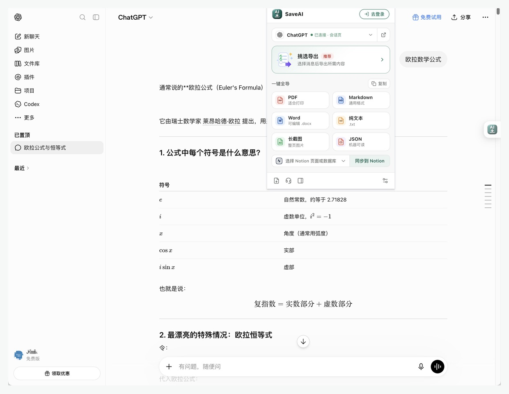
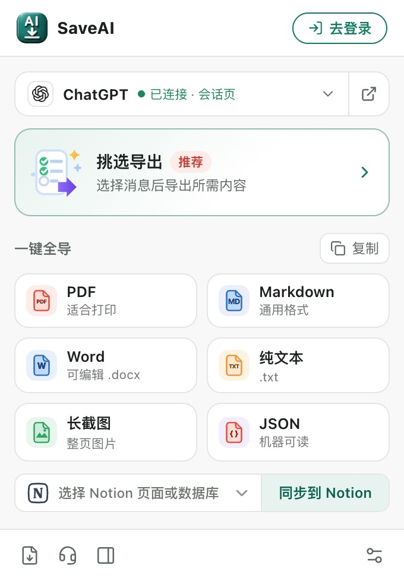
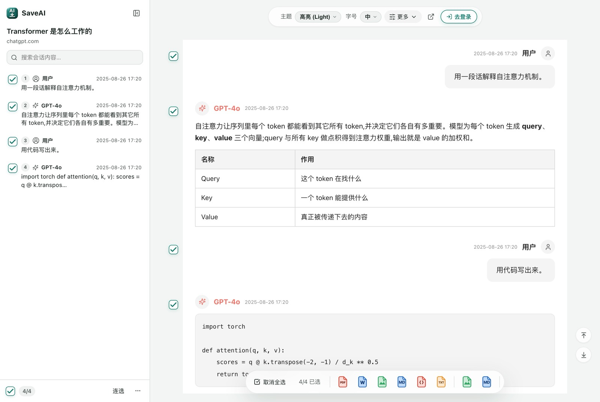
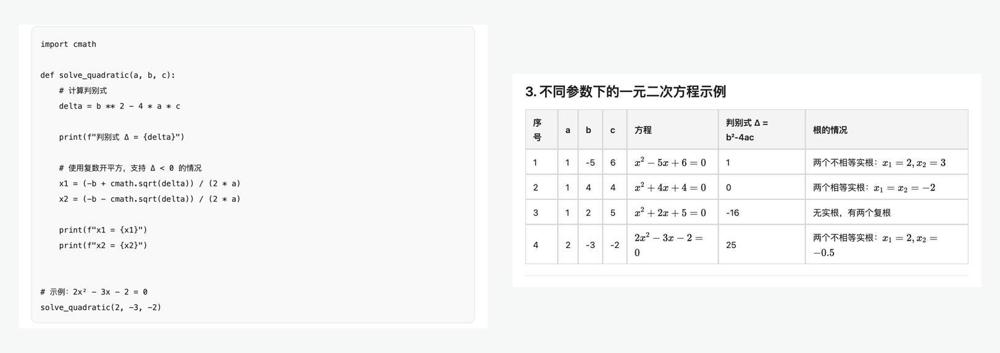
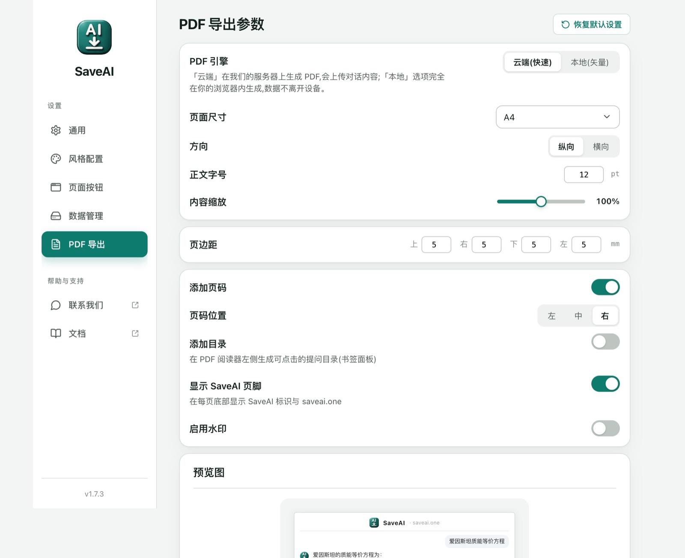
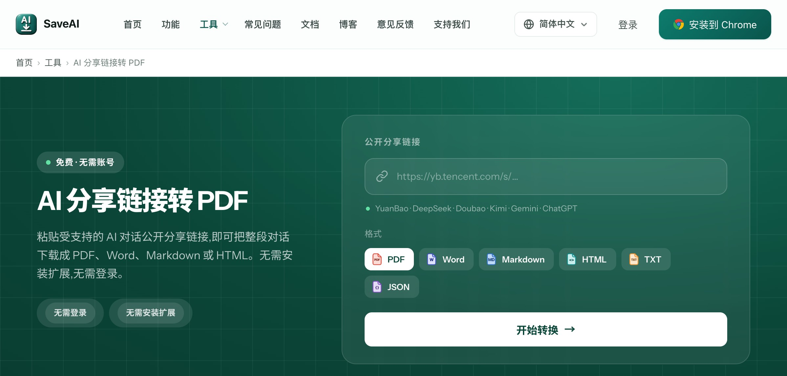

# SaveAI

[English](README.md) · **简体中文**

将 AI 对话保存为 **PDF、Word、Markdown、TXT、JSON 或长截图**，也可以同步到 Notion。SaveAI 是一款浏览器扩展，支持 ChatGPT、Claude、Gemini、DeepSeek、Copilot、Grok、Kimi、豆包、通义千问等 20 个 AI 站点。

[官网](https://saveai.one) · [使用指南](https://www.saveai.one/zh/docs/) · [意见反馈](https://www.saveai.one/zh/feedback/)

**安装扩展：** [Chrome](https://chromewebstore.google.com/detail/lkhaghcekfkickbdachbheceknpmofdk) · [Edge](https://microsoftedge.microsoft.com/addons/detail/ohgnnmliihahfpdeggnojlednaklbbce) · [Firefox](https://addons.mozilla.org/firefox/addon/save-ai-chats-to-pdf-word/)



## 1、我为什么做 SaveAI

大家好，我叫 **Jack**，是 SaveAI 插件的作者，也是一名对软件细节有些较真的工程师。

最初，我只是想找一个顺手的工具，把工作中与 AI 的对话整理保存下来。讨论过的代码、推导过的公式、反复修改的方案，我希望以后需要时能方便地翻出来，而不用再到不同的网站里寻找。

但试过一些工具后，我总觉得还差一点：有的导出格式不全，有的保存后公式或特殊字符变了样；有的需要付费，而付费也未必能解决这些问题。对我来说，文件能下载下来只是第一步，里面的内容也应该完整、清楚，拿来就能用。

既然自己就是做软件的，不如动手做一个。这样，功能可以按实际需要来设计，遇到不顺手的地方也能继续改。我希望它先成为自己愿意每天使用的工具，再免费分享给有同样需求的人。SaveAI 就这样开始了。

发布之后，SaveAI 收到了许多用户的关注、支持和真诚的反馈，这是最初没有想到的。每一条评价、每一封邮件，我都认真看过。你们指出的问题和分享的使用场景，帮我发现了自己没注意到的细节，也给了我继续优化的动力。**谢谢你们，让这个从个人需求出发的小工具，逐渐变得更好用。**

## 2、主要功能

- 一个扩展，支持 20 个 AI 站点的对话导出。
- 六种文件格式可选，也可以同步到已授权的 Notion 页面或数据库。
- 一键保存整段对话，或在预览页逐条挑选需要的消息。
- 通过工具栏弹窗、页内按钮或浏览器右键菜单发起导出。
- 提供 8 种阅读主题，支持调整字体、字号和内容宽度。
- 可设置 PDF 纸张大小、方向、页边距、目录、页码和页脚。
- 在扩展侧边栏中搜索和回看已捕获的对话。

SaveAI 目前免费提供各项导出功能，普通文件导出无需注册账号。

## 3、选择适合自己的格式

| 格式 | 适合的场景 | 保存后的用途 |
| --- | --- | --- |
| PDF | 分享、打印和归档 | 固定排版，方便阅读与分发 |
| Word | 继续修改方案或报告 | 生成可编辑的 `.docx` 文档 |
| Markdown | Obsidian、笔记库和后续整理 | 保留标题、列表与代码等结构 |
| TXT | 只需要文字内容 | 轻量保存，便于复制与检索 |
| JSON | 交给脚本继续处理 | 保存结构化的对话数据 |
| 长截图 | 分享完整的阅读画面 | 将对话保存为长图 |



## 4、快速上手

1. 安装适合自己浏览器的 SaveAI 扩展，并固定到工具栏。
2. 在受支持的 AI 站点中打开想保存的对话。
3. 点击 SaveAI 图标，在 **一键全导** 中选择格式。
4. 如果只想保存部分内容，进入 **挑选导出**，勾选需要的消息，再导出选中内容。

导出长对话前，请先确认早期消息已经加载。部分 AI 站点只展示当前可见的内容，必要时先向上滚动，再检查预览页里的消息列表是否完整。

图片与附件能否一并保存，取决于源站是否允许读取，以及所选导出格式的支持范围。

## 5、界面与导出效果

<details>
<summary>5.1 消息挑选与导出预览</summary>

在左侧勾选消息，在右侧查看对话内容，再导出需要保留的部分。



</details>

<details>
<summary>5.2 代码与表格导出示例</summary>

官网中的导出效果示例，展示保留缩进的代码块和包含数学公式的表格。



</details>

<details>
<summary>5.3 PDF 导出设置</summary>

选择云端或本地 PDF 引擎，并调整文档排版。



</details>

<details>
<summary>5.4 公开分享链接导出工具</summary>

官网的 [分享链接导出工具](https://www.saveai.one/zh/tools/share-to-pdf/) 可以读取受支持的 AI 公开分享链接，无需安装扩展即可选择格式并下载。需要登录才能读取的对话，请在自己的浏览器会话中通过扩展导出。



</details>

截图取自 SaveAI 官网与扩展使用指南，界面选项以所安装版本为准。

## 6、隐私与数据处理

- **本地文件生成：** Word、Markdown、TXT、JSON 和长截图在浏览器本地生成。
- **PDF 渲染：** 默认使用云端引擎，会将对话内容上传到 SaveAI 服务器进行渲染。选择本地引擎后，可在自己的设备上通过浏览器打印保存 PDF。
- **对话缓存：** 已捕获的对话保存在浏览器本地缓存中。你可以调整保留时长或清理缓存，重要资料建议另外导出文件保存。
- **Notion 同步：** 选中的内容会发送到你已授权的 Notion 目标。
- **官网分享链接工具：** 服务器会读取受支持的公开分享链接，为后续导出准备对话内容。

详细说明请查看 [隐私政策](https://www.saveai.one/zh/privacy/)。

## 7、源码构建参考

本仓库存放项目介绍和界面截图。以下开发说明适用于完整的扩展源码工程，技术栈为 React、TypeScript 和 Manifest V3，已记录的构建环境为 **Node.js 22.x** 和 **npm 10.x**。

```bash
npm ci
npm run build            # Chrome 和 Edge：输出到 dist/
npm run build:firefox    # Firefox：输出到 dist-firefox/
node scripts/package.mjs # Chrome 安装包：releases/save-ai-<version>.zip
```

完整构建流程与 Firefox 源码压缩包说明，请查看扩展源码工程中的 `BUILD.md`。

加载本地构建：

- **Chrome 或 Edge：** 打开 `chrome://extensions` 或 `edge://extensions`，启用开发者模式，选择 **加载已解压的扩展程序**，然后选中 `dist/` 目录。
- **Firefox：** 打开 `about:debugging`，进入 **此 Firefox**，选择 **临时载入附加组件**，然后选中 `dist-firefox/manifest.json`。

## 8、源码工程结构

```text
src/
├── popup/          # 工具栏弹窗
├── options/        # 设置页面
├── preview/        # 导出预览与消息挑选
├── sidepanel/      # 对话列表与批量导出
├── content-new/    # 各站点适配与页内导出控件
├── inject-web/     # 与 AI 站点页面上下文的通信桥接
├── background/     # 扩展后台、请求路由与右键菜单
└── shared/         # 设置、本地化与共享工具
scripts/            # 构建、打包与回归检查
vendor/upstream/    # 静态构建输入：清单、语言包和图标
```

## 9、开发检查

在完整的扩展源码工程中运行：

```bash
npx tsc -b
node scripts/test-ui-regressions.mjs
node scripts/test-package-regressions.mjs
node scripts/test-usage-optout.mjs
```

## 10、意见反馈

如果你遇到漏消息、排版问题，或者有想要的功能，欢迎通过 [官网意见反馈](https://www.saveai.one/zh/feedback/) 告诉我。也欢迎说说你用它保存了什么、准备怎样使用这些内容。这些具体的反馈，会帮助我把 SaveAI 做得更贴近日常需要。
